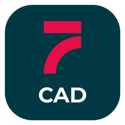

# STAR CAD

Aplicativo CAD da suíte STAR7, derivado do projeto open-source CADCraft. Esta distribuição modifica a identidade visual; os nomes internos, formatos de arquivo e identificadores de instalação são mantidos para compatibilidade.

## Documentação

A documentação técnica completa, instruções de compilação, funcionalidades e limitações foram preservadas no histórico: [documentação original desta versão](https://github.com/Devstar7/cadcraft/blob/9436f40885cf75358215f2e6fe20fbaac3fdd845/README.md).

- [Documentação do projeto](docs/)
- [Planejamento](ROADMAP.md)
- [Suíte STAR7](https://suite.star-7.app.br)

## Licenças e origem

CADCraft é disponibilizado sob [MIT](LICENSE-MIT) ou [Apache-2.0](LICENSE-APACHE). Copyright (c) 2026 ArtCraft Team e contribuidores do CADCraft. Os avisos obrigatórios permanecem em [NOTICE](NOTICE); fontes, imagens e outros recursos mantêm suas próprias licenças em [ATTRIBUTION.md](ATTRIBUTION.md).

As oito imagens de marca ArtCraft listadas em ATTRIBUTION.md são registros históricos de recursos da versão de origem e foram removidas desta distribuição modificada. Os créditos não foram apagados. O aviso original permanece em [docs/brand/LICENSE-brand.txt](docs/brand/LICENSE-brand.txt). A STAR7 não representa nem implica endosso da equipe original.

## Distribuição

A limpeza de imagens de documentação não altera o MSI já publicado. Para mudanças no programa ou instalador, gere e teste um novo pacote antes de publicar em Releases.
